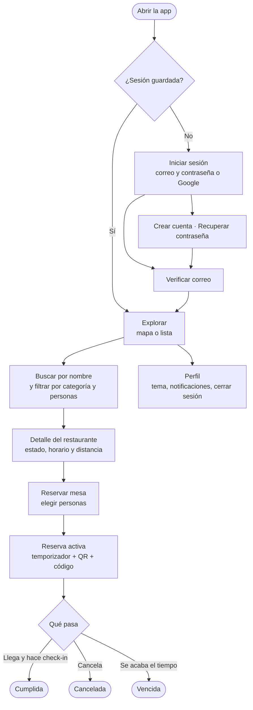
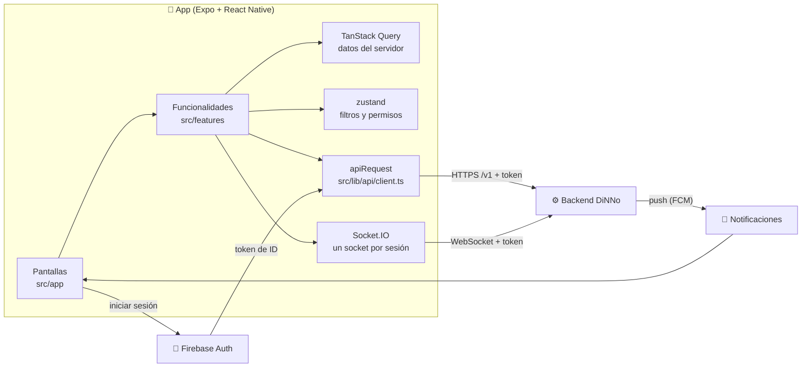

<div align="center">

<picture>
  <source media="(prefers-color-scheme: dark)" srcset="docs/images/logo-dark.svg">
  
</picture>

# 📍 DiNNo · App móvil

### **Dile no a la espera.**

La app del comensal: encuentra un restaurante con mesa disponible *ahora* y asegúrala mientras llegas.

<br/>


</div>

## 📑 Contenido

| | | |
|---|---|---|
| [🧡 Qué es DiNNo](#-qué-es-dinno) | [🧭 Flujo del comensal](#-flujo-del-comensal) | [📱 Pantallas y rutas](#-pantallas-y-rutas) |
| [🏗️ Cómo funciona](#️-cómo-funciona) | [🛠️ Stack](#️-stack-tecnológico) | [🎨 Identidad visual y kit](#-identidad-visual-y-kit) |
| [🚀 Empezar en local](#-empezar-en-local) | [🔑 Variables de entorno](#-variables-de-entorno) | [📜 Scripts](#-scripts-de-npm) |
| [📁 Estructura](#-estructura-del-proyecto) | [🧪 Pruebas y calidad](#-pruebas-y-calidad) | [📦 Builds y publicación](#-builds-y-publicación) |
| [🩺 Problemas comunes](#-problemas-comunes) | [👥 Equipo](#-equipo) | |

---

## 🧡 Qué es DiNNo

DiNNo es un servicio de **microreservas para restaurantes**. El comensal encuentra en esta app un restaurante con mesa disponible en este momento y la asegura mientras llega; el restaurante administra sus mesas desde la web y confirma la llegada con un *check-in*.

- 💸 Se cobra por **comensal** con check-in (**COP 1.500** por comensal).
- 📍 Piloto en la **Calle 72, Bogotá**.
- ⏱️ La reserva dura unos minutos y **vence sola** si el comensal no llega.

Este repositorio es la **app móvil del comensal**. Forma parte de tres repositorios:

| Repositorio | Qué es |
|---|---|
| [`DiNNo-team/mobile`](https://github.com/DiNNo-team/mobile) | 📱 **Este repo**: app del comensal |
| [`DiNNo-team/backend`](https://github.com/DiNNo-team/backend) | ⚙️ API REST y tiempo real que consume la app |
| [`DiNNo-team/frontend`](https://github.com/DiNNo-team/frontend) | 🖥️ Plataforma web del restaurante (mesas, check-in, reportes) |

> [!NOTE]
> En la app solo entran cuentas de **comensal**. Si alguien inicia sesión con una cuenta de restaurante, la app le explica que debe administrar su restaurante desde la web.

---

## 🧭 Flujo del comensal



1. **Abre la app.** Si ya había iniciado sesión, la sesión se restaura sola; si no, ve la pantalla de inicio de sesión.
2. **Inicia sesión** con correo y contraseña o con Google, o **crea una cuenta** (con verificación de correo y recuperación de contraseña).
3. **Explora** los restaurantes que se pueden reservar ahora, en un **mapa** o en una **lista**. Puede buscar por nombre y filtrar por categoría y número de personas. Si da su ubicación, ve la distancia («a 650 m») y los más cercanos primero.
4. **Ve el detalle**: estado (Disponible, Pocas mesas, Sin mesas, Cerrado), dirección, horario de la semana y «Cómo llegar».
5. **Reserva una mesa**: elige las personas (de 1 a 20) y la app muestra por cuánto tiempo se guarda la mesa. Solo puede tener **una reserva activa** a la vez.
6. **Muestra su reserva** como un tiquete con **temporizador** (calculado con la hora del servidor), **código de 6 caracteres** y **QR** (se puede ampliar). El restaurante lo lee en la web para confirmar el check-in.
7. **Cancela** (con confirmación) o la deja vencer. La pantalla muestra el estado final: Cumplida, Cancelada o Vencida.
8. **Recibe avisos**: notificaciones de la reserva y un recordatorio local «Tu reserva vence pronto», además de avisos dentro de la app (toast) cuando cambia algo en tiempo real.
9. **Perfil**: ve su cuenta, elige el tema (Sistema, Claro u Oscuro), activa las notificaciones y cierra sesión.

---

## 📱 Pantallas y rutas

La navegación es **basada en archivos** ([Expo Router](https://docs.expo.dev/router/introduction/)): cada archivo de `src/app/` es una ruta.

| Ruta | Archivo | Qué muestra |
|---|---|---|
| `/` | `src/app/(app)/(tabs)/index.tsx` | **Explorar**: mapa o lista de restaurantes, búsqueda por nombre y filtros |
| `/perfil` | `src/app/(app)/(tabs)/perfil.tsx` | **Perfil**: cuenta, tema, notificaciones y cerrar sesión |
| `/restaurante/[id]` | `src/app/(app)/restaurante/[id].tsx` | **Detalle** del restaurante y botón «Reservar mesa» |
| `/reserva/[id]` | `src/app/(app)/reserva/[id].tsx` | **Reserva**: tiquete con temporizador, QR y código; cancelar; estado final |
| `/login` | `src/app/(auth)/login.tsx` | Iniciar sesión (correo o Google) |
| `/crear-cuenta` | `src/app/(auth)/crear-cuenta.tsx` | Crear cuenta de comensal |
| `/recuperar-contrasena` | `src/app/(auth)/recuperar-contrasena.tsx` | Recuperar contraseña |
| `/verificar-correo` | `src/app/(auth)/verificar-correo.tsx` | Pide verificar el correo antes de continuar |
| `/cuenta-restaurante` | `src/app/(auth)/cuenta-restaurante.tsx` | Aviso: la cuenta es de restaurante y se administra desde la web |
| `/sin-conexion` | `src/app/(auth)/sin-conexion.tsx` | No se pudo contactar al servidor; permite reintentar |
| `/conectando` | `src/app/(auth)/conectando.tsx` | Estado de espera mientras se restaura o valida la sesión |
| `/kit` | `src/app/kit.tsx` | Catálogo del kit visual (**solo en desarrollo**, `__DEV__`) |

> [!NOTE]
> Las rutas no se abren a mano: el grupo `(auth)` o `(app)` se activa según el **estado de la sesión** con `Stack.Protected`. No hay barra de pestañas; Perfil se abre desde el avatar del buscador de Explorar.

---

## 🏗️ Cómo funciona



### 🔐 Sesión y token

- Autenticación con **Firebase Authentication** (JS SDK con persistencia en el teléfono) y **Google Sign-In nativo**.
- `SessionProvider` (`src/features/session/`) expone `useAuth()` y ejecuta **un solo flujo** tras cualquier inicio de sesión: `GET /me` → si no hay perfil, `POST /diners/me` → estado de la sesión.
- Estados de la sesión: `restoring`, `resolving`, `signed-out`, `email-not-verified`, `restaurant-account`, `unreachable` y `ready`. Cada estado habilita sus pantallas.
- Al cerrar sesión se borra la caché de consultas, los filtros y el socket.

### 🌐 Cliente HTTP

- Toda llamada pasa por `apiRequest` (`src/lib/api/client.ts`): agrega el token de Firebase, aplica un **tiempo máximo de 60 s** y normaliza los errores (`ApiError` con `status`, `errorCode` y `kind`).
- La URL sale **solo** de `src/config/env.ts`: `EXPO_PUBLIC_API_URL` + el prefijo `/v1`.
- Los textos de error que ve la persona salen del `errorCode` (`getErrorMessage`), nunca del mensaje técnico del servidor.
- Cada dominio tiene un `api.ts` que elige entre el backend real y datos de ejemplo (`EXPO_PUBLIC_USE_MOCKS`).

### 🗃️ Estado y datos

| Qué | Dónde |
|---|---|
| Datos del servidor (restaurantes, detalle, perfil, reserva activa) | **TanStack Query** (`queries.ts` de cada funcionalidad). Reintenta errores de red y 5xx; no reintenta 4xx |
| Lo que eligió el comensal (texto de búsqueda, filtros, ubicación) | **zustand** (`src/features/search/store.ts`); se borra al cerrar sesión |
| Permiso de notificaciones | **zustand** (`src/features/notifications/push.ts`) |
| Tema (Sistema, Claro u Oscuro) | `ThemeProvider` (`src/theme/`), guardado en el teléfono |

### ⚡ Tiempo real

- **Un solo socket por sesión** (`src/features/realtime/socket.ts`), autenticado con el token de Firebase y renovado en cada reconexión.
- `availability.changed`: la disponibilidad de un restaurante se actualiza al instante en el mapa, la lista y el detalle, sin recargar.
- `reservation.cancelled`, `reservation.expired` y `reservation.checked_in`: la reserva cambia de estado y la app avisa con un toast.
- **Respaldo** si el socket falla: consulta cada 60 s en búsqueda y detalle, y de nuevo al volver a la app o al recuperar internet. Si una petición tarda más de 5 s aparece «Conectando con DiNNo…».
- Con datos de ejemplo (`EXPO_PUBLIC_USE_MOCKS=true`) no hay socket.

### 🔔 Notificaciones

- **Push remota** (FCM en Android): el teléfono se registra en el backend al iniciar sesión y se da de baja antes de cerrar sesión. El comensal recibe avisos cuando la reserva se crea, se cancela, vence o tiene check-in; al tocar el aviso se abre la reserva.
- **Recordatorio local** «Tu reserva vence pronto»: lo programa la app (5 minutos antes del vencimiento, o 1 minuto antes si la reserva dura 5 minutos o menos), con la hora del servidor, y se cancela si la reserva termina antes.
- Los textos de la push los define el backend y no incluyen el código de la reserva.

### 🗺️ Mapa y ubicación

- `react-native-maps` con **Google Maps** en Android y iOS. Sin llave de Maps en el build, la app funciona y muestra solo la lista.
- La **ubicación es opcional** (`expo-location`, solo en primer plano): con ella las tarjetas muestran la distancia y se ordenan de la más cercana a la más lejana; sin ella se ordenan por nombre.

---

## 🛠️ Stack tecnológico

Versiones tomadas de [`package.json`](package.json).

| Capa | Tecnología | Versión |
|---|---|---|
| Framework | [Expo](https://expo.dev) | `~57.0.30` (SDK 57) |
| Runtime | React Native · React | `0.86.3` · `19.2.3` |
| Lenguaje | TypeScript (modo `strict`) | `~6.0.3` |
| Navegación | Expo Router (rutas tipadas) | `~57.0.28` |
| Compilador | React Compiler (`experiments.reactCompiler`) | activado en `app.config.ts` |
| Estilos | NativeWind · Tailwind CSS | `^4.2.7` · `^3.4.19` |
| Datos del servidor | TanStack Query | `^5.104.3` |
| Estado local | zustand | `^5.0.15` |
| Autenticación | Firebase JS SDK · Google Sign-In nativo | `^13.0.0` · `^16.1.5` |
| Tiempo real | socket.io-client | `^4.8.4` |
| Mapa | react-native-maps (Google Maps) | `1.27.2` |
| Ubicación | expo-location | `~57.0.21` |
| Notificaciones | expo-notifications (FCM) | `~57.0.25` |
| Animación | react-native-reanimated · worklets | `4.5.1` · `0.10.1` |
| Íconos | lucide-react-native | `^1.57.0` |
| Tipografía | Plus Jakarta Sans (`@expo-google-fonts`) | `^0.4.2` |
| QR | qrcode-generator | `^2.0.4` |
| Red | @react-native-community/netinfo | `12.0.1` |
| Pruebas | Jest + jest-expo | `~29.7.0` · `~57.0.6` |
| Lint | ESLint + eslint-config-expo | `^9.39.5` · `~57.0.2` |
| Entorno | Node.js | `24.x` |

---

## 🎨 Identidad visual y kit

El **manual de identidad v2.0** manda sobre cualquier otra preferencia. Todos los valores de diseño viven en [`src/theme/tokens.ts`](src/theme/tokens.ts) y se cargan en `tailwind.config.js`.

### Paleta base

| Rol | Modo claro | Modo oscuro |
|---|---|---|
| Fondo (`bg`) | `#FAF7F1` crema | `#0B2D36` petróleo noche |
| Superficie (`surface`) | `#FFFFFF` | `#103B46` petróleo |
| Texto (`text`) | `#10252B` | `#FAF7F1` |
| Acento (`accent`) | `#F46935` naranja | `#FF8456` |
| Marca (`brand`) | `#103B46` petróleo | `#103B46` |
| Disponible (`ok`) | `#2B8F62` | `#3FBF86` |
| Pocas mesas (`limited`) | `#B7801F` | `#E0A93B` |
| Reservada (`reserved`) | `#4E66C9` | `#8DA2F0` |
| Error (`error`) | `#C8453A` | `#FF7B6E` |

### Tipografía, íconos y movimiento

- **Plus Jakarta Sans** (500, 700 y 800), incrustada en el build con el plugin de `expo-font`. Texto siempre con el componente `Text` del kit (`variant`, `tone`).
- **Lucide** para los íconos (`lucide-react-native`).
- **Modo claro y oscuro** automáticos, con selector manual en Perfil.
- **Vidrio** (`GlassSurface`) para lo que flota sobre el mapa; **movimiento** con Reanimated, escala al presionar y respeto por «reducir movimiento»; **háptica** solo desde `src/lib/haptics.ts`.

### Kit de componentes

`src/components/ui/` reúne 31 componentes (botones, campos, tarjetas, chips de estado, hojas inferiores, diálogos, tiquete, anillo de cuenta regresiva, marcadores de mapa, toasts, esqueletos…). Las pantallas se arman **solo** con el kit y las clases de los tokens (`bg-surface text-fg border-line rounded-card`); la paleta genérica de Tailwind está desactivada.

En desarrollo, la ruta `/kit` muestra el catálogo completo.

> [!NOTE]
> El repositorio todavía no incluye capturas ni mockups (no existe la carpeta `docs/`). Cuando se agreguen, este es el lugar para mostrarlos.

---

## 🚀 Empezar en local

### ✅ Requisitos

| Qué | Detalle |
|---|---|
| **Node.js 24** | Fijado en `.nvmrc` y `engines`. Con nvm: `nvm use` |
| **Android Studio** | Con **SDK de Android (plataforma 36)**, Build-Tools, Platform-Tools y Emulator |
| **JDK 17** | El que trae Android Studio (carpeta `jbr`) sirve |
| **Emulador** | Un dispositivo con imagen **«Google Play»**; sin Google Play no funcionan Maps ni Google Sign-In |
| **Variables del sistema** | `JAVA_HOME` y `ANDROID_HOME`, y `platform-tools` y `emulator` en el `PATH` |
| **iOS (opcional)** | Solo en Mac, con Xcode |

> [!IMPORTANT]
> **La app no corre en Expo Go.** Google Sign-In y Google Maps necesitan código nativo y el paquete propio `com.dinno.app`, así que se usa un **development build** (`expo-dev-client`). No hace falta cuenta de Expo para compilarlo en el emulador.

> [!WARNING]
> En **Windows**, clona el repo **fuera de OneDrive** y en una ruta corta (por ejemplo `C:\dev\dinno\mobile`): las rutas largas rompen Gradle.

### 1️⃣ Instalar

```bash
git clone https://github.com/DiNNo-team/mobile.git dinno-mobile
cd dinno-mobile
nvm use            # opcional, usa Node 24
npm ci
cp .env.example .env   # y completa los valores (ver la sección siguiente)
```

### 2️⃣ Compilar el development build (la primera vez)

Con el emulador encendido:

```bash
npx expo run:android
```

Genera la carpeta `android/` (no se versiona), compila con Gradle, instala **DiNNo** en el emulador y abre el servidor de desarrollo. La primera compilación tarda varios minutos.

Cada vez que cambie algo **nativo** (`app.config.ts`, fuentes, una librería con código nativo o las llaves de Maps) hay que regenerar `android/`:

```bash
npx expo prebuild --clean
npx expo run:android
```

### 3️⃣ Día a día

Si solo cambias código TypeScript, el build ya instalado se conecta al servidor de desarrollo:

```bash
npx expo start          # y presiona "a" para abrir en Android
npx expo start -c       # limpia la caché: úsalo después de cambiar .env o tailwind.config.js
npx expo start --tunnel # si la red (por ejemplo, una universidad) bloquea la conexión directa
```

> [!TIP]
> Después de cada `git pull`, corre `npm ci` antes de cualquier otro comando: si alguien agregó una dependencia, los comandos fallan sin eso.

### 🌐 ¿A qué backend se conecta?

| Modo | Configuración en `.env` | Notas |
|---|---|---|
| **Backend desplegado** (por defecto) | `EXPO_PUBLIC_API_URL` con la URL del backend desplegado (ver `.env.example`), `EXPO_PUBLIC_USE_MOCKS=false` y las tres `EXPO_PUBLIC_FIREBASE_*` | Funciona desde cualquier red |
| **Backend local** | `EXPO_PUBLIC_API_URL=http://10.0.2.2:3000` y `EXPO_PUBLIC_USE_MOCKS=false` | Corre el backend en tu computador (ver su README) |
| **Datos de ejemplo** | `EXPO_PUBLIC_USE_MOCKS=true` | Sin backend ni Firebase, y sin tiempo real |

> [!IMPORTANT]
> `EXPO_PUBLIC_API_URL` **no puede ser `localhost`**: en un emulador `localhost` es el propio emulador. Usa `http://10.0.2.2:3000` (el computador visto desde el emulador de Android), la **IP del computador** en tu red si pruebas en un teléfono físico, o la URL del backend desplegado. Debe ir **sin `/v1` y sin `/` final**.

### 🔐 Google Maps y Google Sign-In

Ambos están restringidos al paquete **`com.dinno.app`** y al **SHA-1** del certificado con que se firma el build.

- El build de desarrollo usa el `debug.keystore` que trae la plantilla de Expo, así que el SHA-1 es **el mismo en todos los computadores**. Para verlo en tu equipo (después de `npx expo run:android` o `npx expo prebuild`):

  ```bash
  keytool -list -v -keystore android/app/debug.keystore -storepass android -alias androiddebugkey | grep SHA1
  # o: cd android && ./gradlew signingReport
  ```
- **Google Sign-In** necesita en Google Cloud un cliente OAuth de **Android** con `com.dinno.app` y ese SHA-1, y el ID de cliente **web** del proyecto de Firebase en `EXPO_PUBLIC_GOOGLE_WEB_CLIENT_ID`. Sin él, el botón muestra un error y el resto de la app funciona.
- **Google Maps** necesita una llave de **Maps SDK for Android** en `GOOGLE_MAPS_ANDROID_API_KEY` (y de **Maps SDK for iOS** en `GOOGLE_MAPS_IOS_API_KEY`). La llave se lee al **compilar**, no en JavaScript: después de ponerla o cambiarla hay que correr `npx expo prebuild --clean` y `npx expo run:android`.
- Las llaves y los valores reales **no están en el repositorio**: se piden al equipo por un canal privado.

<details>
<summary>🍎 iOS (solo en Mac)</summary>

```bash
npx expo prebuild --clean --platform ios
npx expo run:ios
```

- La carpeta `ios/` tampoco se versiona.
- `app.config.ts` incluye ajustes propios de iOS: adopta el ciclo de vida por escenas (`UIScene`) que exigen las versiones nuevas de iOS, quita el permiso `aps-environment` salvo que `IOS_PUSH_ENABLED=true` (un Apple ID gratuito no puede firmarlo) y lee el cliente de Google Sign-In de `GoogleService-Info.plist`.
- Sin el programa de pago de Apple no hay push remota en iOS: solo el recordatorio local.

</details>

<details>
<summary>📍 Simular la ubicación en el emulador de Android</summary>

Con el emulador encendido, **longitud primero y luego latitud**:

```bash
adb emu geo fix -74.0567 4.6576    # Calle 72
adb emu geo fix -74.0306 4.6949    # Usaquén
```

El emulador arranca en California: hasta que envíes una posición, la ubicación no encuentra restaurantes cercanos. También puedes usar *⋯ (Extended controls) → Location*.

</details>

---

## 🔑 Variables de entorno

Solo se documentan los **nombres**; los valores nunca van en el repositorio. Copia [`.env.example`](.env.example) a `.env` y complétalo. Las variables se leen **solo** en [`src/config/env.ts`](src/config/env.ts) y en `app.config.ts`.

> [!WARNING]
> Las variables `EXPO_PUBLIC_*` quedan **dentro de la app**: nunca pongas secretos en ellas. `.env` no se versiona.

| Variable | Obligatoria | Para qué sirve |
|---|---|---|
| `EXPO_PUBLIC_API_URL` | Sí | Origen del backend, sin `/v1` y sin `/` final |
| `EXPO_PUBLIC_USE_MOCKS` | No | `true` usa datos de ejemplo en memoria y no llama al backend |
| `EXPO_PUBLIC_DEV_USER_ID` | No | Solo con backend local: usuario de prueba que se envía como `x-dev-user-id` cuando no hay sesión de Firebase |
| `EXPO_PUBLIC_FIREBASE_API_KEY` | Sí (salvo con datos de ejemplo) | Configuración pública de Firebase |
| `EXPO_PUBLIC_FIREBASE_AUTH_DOMAIN` | Sí (salvo con datos de ejemplo) | Configuración pública de Firebase |
| `EXPO_PUBLIC_FIREBASE_PROJECT_ID` | Sí (salvo con datos de ejemplo) | Configuración pública de Firebase |
| `EXPO_PUBLIC_GOOGLE_WEB_CLIENT_ID` | Para «Continuar con Google» | ID de cliente web de OAuth del proyecto de Firebase |
| `GOOGLE_MAPS_ANDROID_API_KEY` | No (sin ella, solo lista) | Llave de Maps para Android. **Sin** `EXPO_PUBLIC_`: va al build nativo |
| `GOOGLE_MAPS_IOS_API_KEY` | No (sin ella, solo lista en iOS) | Llave de Maps para iOS. **Sin** `EXPO_PUBLIC_` |
| `IOS_PUSH_ENABLED` | No | `true` solo con el programa de pago de Apple (push remota en iOS) |

Si no existe `.env` o falta `EXPO_PUBLIC_API_URL`, la app muestra un error claro al abrir. Con `EXPO_PUBLIC_USE_MOCKS=true` hay una sesión de ejemplo: cualquier correo entra como comensal.

---

## 📜 Scripts de npm

| Comando | Qué hace |
|---|---|
| `npm start` | Servidor de desarrollo (`expo start`) |
| `npm run android` | Compila e instala el development build en Android (`expo run:android`) |
| `npm run android:release` | Compila una variante *release* de Android (`expo run:android --variant release`) |
| `npm run ios` | Compila e instala en el simulador de iOS, solo en Mac (`expo run:ios`) |
| `npm run web` | Servidor de desarrollo para web (`expo start --web`); el equipo no usa la app en web |
| `npm run lint` | ESLint (`expo lint`) |
| `npm run typecheck` | Regenera los tipos de Expo y corre `tsc --noEmit` |
| `npm test` | Pruebas con Jest (`jest`) |

Otros comandos útiles: `npx expo prebuild --clean` (regenera `android/` o `ios/` desde `app.config.ts`) y `npx expo-doctor` (diagnóstico de dependencias).

> [!TIP]
> Usa `npm run typecheck` y no `npx tsc --noEmit` suelto: los tipos de rutas de Expo se generan y no están en git, y si faltan o están viejos, `tsc` da errores falsos.

---

## 📁 Estructura del proyecto

| Ruta | Qué contiene |
|---|---|
| `src/app/` | Pantallas y navegación (Expo Router). **Solo rutas**: `(auth)/`, `(app)/(tabs)/`, `(app)/restaurante/`, `(app)/reserva/`, `kit.tsx` |
| `src/components/ui/` | Kit visual de la app (botones, campos, tarjetas, hojas, tiquete, toasts…) |
| `src/components/` | Componentes compartidos que no son del kit (`AmbientGround`, `SlowConnectionNotice`) |
| `src/features/session/` | Inicio de sesión, Firebase, Google Sign-In, flujo del perfil y `SessionProvider` |
| `src/features/account/` | Perfil de la cuenta (`GET /me`) |
| `src/features/search/` | Explorar: restaurantes, filtros, mapa, tarjetas y horario |
| `src/features/reservations/` | Reservar, reserva activa, temporizador, QR, cancelar y estados finales |
| `src/features/realtime/` | Socket único y eventos de disponibilidad y de reservas |
| `src/features/notifications/` | Push (FCM), permiso, recordatorio local y apertura desde el aviso |
| `src/features/location/` | Ubicación opcional del comensal |
| `src/lib/` | Cliente HTTP (`api/`), formato de distancia y mesa, cliente de consultas, háptica y geografía |
| `src/theme/` | Tokens del manual, variables de color y `ThemeProvider` (claro/oscuro) |
| `src/config/env.ts` | Único lugar donde se leen las variables de entorno |
| `src/dev/kit/` | Pantalla del catálogo del kit (solo desarrollo) |
| `src/global.css` | Estilos globales de NativeWind |
| `assets/images/` | Ícono, splash, ícono de notificación y logo de Google |
| `app.config.ts` | Configuración nativa (paquete, plugins, permisos, splash). Reemplaza a `app.json` |
| `tailwind.config.js` · `babel.config.js` · `metro.config.js` | Tokens en Tailwind y configuración de NativeWind |
| `google-services.json` · `GoogleService-Info.plist` | Configuración pública de Firebase para Android e iOS |
| `jest.setup.js` · `eslint.config.js` · `tsconfig.json` | Pruebas, lint y TypeScript |
| `android/` · `ios/` | Se **generan** con `prebuild`; no se versionan ni se editan a mano |

Los imports usan el alias `@/` para `src/`. Cada funcionalidad guarda sus tipos de la API en `types.ts` y sus llamadas en `api.ts`.

---

## 🧪 Pruebas y calidad

| Qué | Comando | Resultado |
|---|---|---|
| Pruebas (Jest + `jest-expo`) | `npm test` | ✅ **163 pruebas en 27 suites** |
| Tipos (TypeScript `strict`) | `npm run typecheck` | ✅ sin errores |
| Lint (ESLint + `eslint-config-expo`) | `npm run lint` | ⚠️ ver nota |

Las pruebas cubren, entre otras cosas: temporizador y recordatorio de la reserva, mensajes de error por `errorCode`, flujo de sesión y de Google, validaciones, formato de distancia y mesa, filtros y caché en tiempo real, y componentes del kit.

> [!NOTE]
> En la medición hecha para este README, `npm run lint` reportó 4 errores `import/no-unresolved` sobre `expo-notifications` y `qrcode-generator`, aunque ambos paquetes están instalados y las pruebas y los tipos pasan. Parece un problema del resolvedor de ESLint en este entorno, no del código, y queda por revisar. No se midió la cobertura.

---

## 📦 Builds y publicación

El repositorio **no tiene** `eas.json` ni flujos de GitHub Actions: hoy no hay una canalización de despliegue de la app. Lo que existe:

- **Desarrollo:** *development build* en el emulador (`npx expo run:android`), contra el backend desplegado o uno local.
- **Prueba de la variante *release* en Android:** `npm run android:release` compila un APK con el JavaScript adentro. Usa los valores de `.env` del momento de compilar.

```bash
npx expo prebuild --clean
npm run android:release
# queda en android/app/build/outputs/apk/release/app-release.apk
```

Quien lo reciba lo instala con `adb install -r app-release.apk` o arrastrándolo al emulador. Va firmado con el mismo `debug.keystore`, así que comparte el SHA-1 del build de desarrollo.

---

## 🩺 Problemas comunes

<details>
<summary>Ver tabla de problemas</summary>

| Síntoma | Causa y solución |
|---|---|
| «Falta EXPO_PUBLIC_API_URL…» al abrir la app | No hay `.env` o le falta la variable. `cp .env.example .env`, complétala y reinicia con `npx expo start -c` |
| «Faltan EXPO_PUBLIC_FIREBASE_…» | Faltan las variables de Firebase. Pídelas al equipo o usa `EXPO_PUBLIC_USE_MOCKS=true` |
| La app no llega a mi backend local | `localhost` en el emulador es el propio emulador: usa `http://10.0.2.2:3000` y reinicia con `npx expo start -c` |
| El emulador tiene internet pero la app dice «No pudimos conectarnos» | A veces el emulador no resuelve nombres (DNS). Ábrelo con DNS fijos: `emulator -avd <nombre> -dns-server 8.8.8.8,1.1.1.1` |
| La primera petición tarda mucho o aparece «Conectando con DiNNo…» | El backend puede estar iniciando. Espera unos segundos y vuelve a intentar |
| La app se cierra al abrir *Explorar* después de poner la llave de Maps | Se reinició Metro sin recompilar: la llave va dentro del build. `npx expo prebuild --clean` y `npx expo run:android` |
| Cambié `tailwind.config.js` o `.env` y no se nota | Reinicia limpiando la caché: `npx expo start -c` |
| Google responde `DEVELOPER_ERROR` | Falta el cliente OAuth de Android con `com.dinno.app` y el SHA-1, o el ID de cliente web |
| `tsc` dice que una ruta no existe o `TS2882` con `global.css` | Los tipos generados por Expo están viejos. Usa `npm run typecheck` |
| Gradle falla con rutas largas o archivos bloqueados (Windows) | El repo está en OneDrive o en una ruta larga. Muévelo a una ruta corta, por ejemplo `C:\dev\dinno\mobile` |
| `npx jest`, `npx tsc` o `npx expo` descargan paquetes y fallan | Falta `node_modules`. Corre `npm ci` y usa los scripts de npm |

</details>

---

## 👥 Equipo

**Equipo DiNNo** · Escuela Colombiana de Ingeniería Julio Garavito

| Integrante | Rol | GitHub |
|---|---|---|
| Elizabeth Correa Suárez | Backend base, mesas, edición del restaurante, integración y demo | [@Eliza-05](https://github.com/Eliza-05) |
| Juan Sebastián Ortega Muñoz | Kit visual, pantallas de mesas y dueño de esta app | [@Juanseom](https://github.com/Juanseom) |
| Jacobo Díaz | Autenticación y control de acceso | [@Jacobo2025](https://github.com/Jacobo2025) |
| Santiago Carmona | Registro del restaurante (onboarding) | [@Carmo0982](https://github.com/Carmo0982) |
| Sergio Alejandro Idarraga Torres | Estado abierto/cerrado del restaurante y bitácora de mesas | [@ALEJO21005](https://github.com/ALEJO21005) |

---

<div align="center">

**DiNNo** · *Dile no a la espera.* 🧡

</div>
